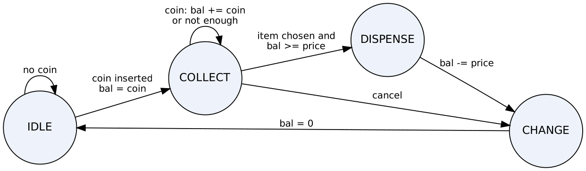
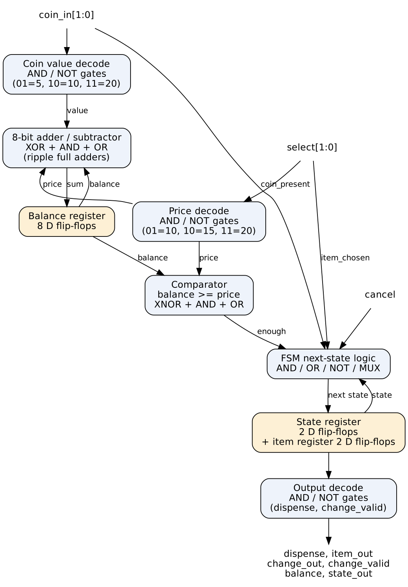
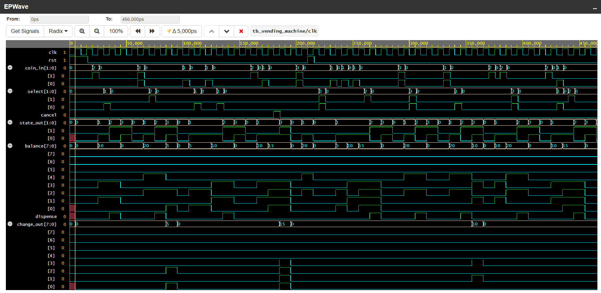
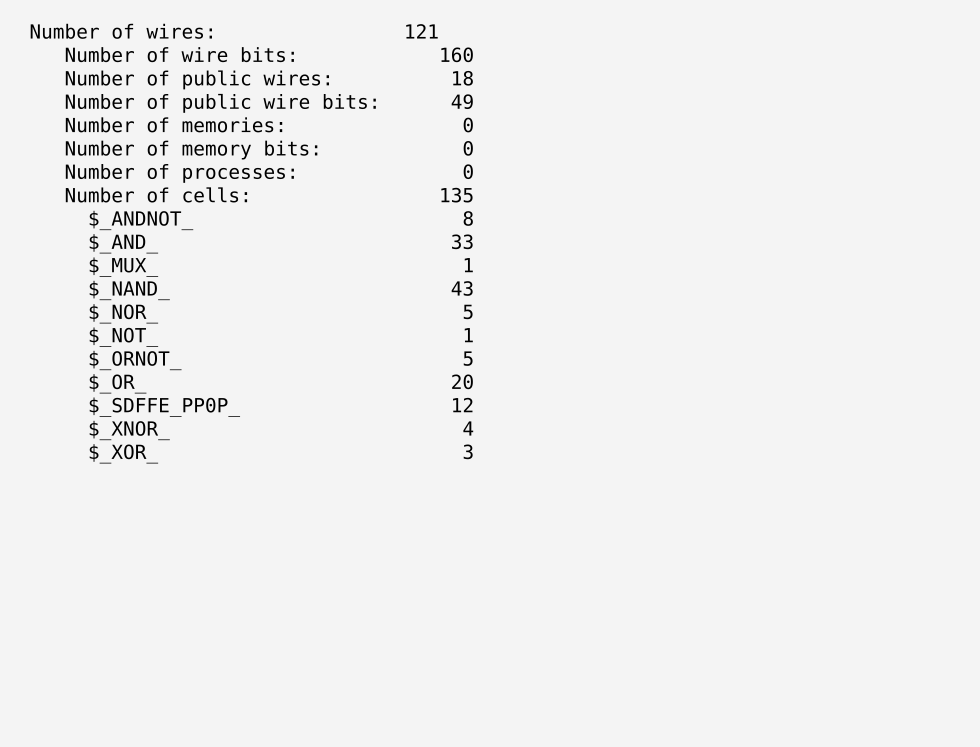

# Smart Vending Machine Controller

Design and verification of a **smart vending machine controller** in Verilog HDL, built for the *Employability Enhancement Course SD0212: RTL Design and Verification* at St. Joseph's College of Engineering (Autonomous), Chennai.

The controller is a four-state finite state machine that accepts coins, tracks the balance, releases the chosen item when enough money is paid, returns exact change, supports a cancel refund, and recovers from reset. It is verified with a self-checking testbench and synthesized to a gate-level netlist with Yosys.

**Run it online:** [EDA Playground](https://edaplayground.com/x/iTmy)

| Result | Value |
|---|---|
| Testbench | 9 scenarios, **34 checks, 0 failures** |
| Simulation length | 466 ns |
| Synthesis (Yosys) | 135 cells: 123 logic gates + 12 D flip-flops |

## Features

- Moore FSM with four states: `IDLE`, `COLLECT`, `DISPENSE`, `CHANGE`
- Coins of Rs 5, Rs 10 and Rs 20, one coin per clock
- Three items: A (Rs 10), B (Rs 15), C (Rs 20)
- Exact change, full refund on `cancel`, synchronous reset
- Priority in `COLLECT`: cancel first, then coin, then item request
- 8-bit balance (up to Rs 255)

## Specification

| Signal | Code | Meaning |
|---|---|---|
| `coin_in[1:0]` | `00` / `01` / `10` / `11` | No coin / Rs 5 / Rs 10 / Rs 20 |
| `select[1:0]` | `00` / `01` / `10` / `11` | None / A (Rs 10) / B (Rs 15) / C (Rs 20) |
| `state_out[1:0]` | `00` / `01` / `10` / `11` | IDLE / COLLECT / DISPENSE / CHANGE |

### Ports

| Port | Direction | Width | Purpose |
|---|---|---|---|
| `clk` | input | 1 | Clock, rising edge |
| `rst` | input | 1 | Synchronous reset, active high |
| `coin_in` | input | 2 | Coin inserted this clock |
| `select` | input | 2 | Item requested |
| `cancel` | input | 1 | Refund request |
| `dispense` | output | 1 | High for one clock when an item is released |
| `item_out` | output | 2 | Item released (valid with `dispense`) |
| `change_out` | output | 8 | Change returned (valid when `change_valid` is high) |
| `change_valid` | output | 1 | High in the CHANGE state |
| `balance` | output | 8 | Money inserted so far |
| `state_out` | output | 2 | Current state code |

## State machine



| From | Condition | To |
|---|---|---|
| IDLE | coin inserted | COLLECT |
| COLLECT | cancel | CHANGE |
| COLLECT | item chosen and balance >= price | DISPENSE |
| DISPENSE | always | CHANGE (price subtracted) |
| CHANGE | always | IDLE (balance cleared) |

## Gate-level architecture



The design has 12 D flip-flops (2 state bits, 8 balance bits, 2 stored-item bits). The logic between them is the coin and price decoders, an 8-bit ripple adder/subtractor, a comparator, the next-state logic and the output decoder.

## Repository structure

```
smart-vending-machine-controller/
├── rtl/
│   └── vending_machine.sv      # RTL design (module vending_machine)
├── tb/
│   └── tb_vending_machine.sv   # self-checking testbench (9 scenarios, 34 checks)
├── synth/
│   ├── syn.ys                  # Yosys synthesis script
│   ├── synth.v                 # synthesized gate-level netlist
│   └── stat.txt                # Yosys cell statistics
├── sim/
│   └── sim.log                 # saved simulation log
├── docs/
│   └── images/                 # diagrams, waveform and synthesis screenshots
├── Makefile
├── LICENSE
└── README.md
```

## How to run

### Option 1: EDA Playground (no installation)

1. Open the [playground link](https://edaplayground.com/x/iTmy).
2. Choose **Icarus Verilog 12.0** and tick **Open EPWave after run**.
3. Click **Run**. The log ends with `ALL TESTS PASSED`.
4. In EPWave, click **Get Signals** and add the signals you want to see.

### Option 2: Local simulation with Icarus Verilog

```bash
sudo apt install iverilog        # or install from https://steveicarus.github.io/iverilog/
make sim
```

Expected output:

```
PASS: 34 checks, FAIL: 0 checks
ALL TESTS PASSED
```

The run writes `sim/dump.vcd`, which you can open in GTKWave.

### Option 3: Synthesis with Yosys

```bash
sudo apt install yosys
make synth
```

This writes `synth/synth.v` and prints the cell statistics (135 cells: 123 gates and 12 flip-flops). Counts can differ slightly between Yosys versions.

## Verification

| # | Scenario | Expected |
|---|---|---|
| 1 | Rs 10 for item A | A released, change 0 |
| 2 | Rs 20 for item B | B released, change Rs 5 |
| 3 | Rs 5 for A, then Rs 5 more | No item at Rs 5, then A |
| 4 | Rs 10 + Rs 5, then cancel | Refund Rs 15, no item |
| 5 | Reset after Rs 20 | IDLE, balance 0 |
| 6 | Select with no coin | Nothing happens |
| 7 | Three Rs 5 coins for B, Rs 20 for C | Both sold, change 0 |
| 8 | Back-to-back sales | A with Rs 10 back, then C |
| 9 | Coin and select in the same clock | Coin added first, item sold on the next request |

### Waveform



## Synthesis result



No FPGA board was used, and no physical timing, power or area was measured.

## Future scope

- More items and coin values, with stock counters and sold-out flags
- Balance limit that rejects extra coins, and a timeout refund
- Card or UPI payment input
- FPGA implementation with timing, power and area measurement, and gate-level simulation

## Team

| Name | Register number |
|---|---|
| Sathyasilan K | 312324106151 |
| Shivram B | 312324106159 |
| Vijayaganesh S | 312324106185 |
| Vishnu Vardhan E | 312324106188 |

Department of Electronics and Communication Engineering, St. Joseph's College of Engineering (Autonomous), OMR, Chennai. Batch 2024-2028.

## License

Released under the [MIT License](LICENSE).
